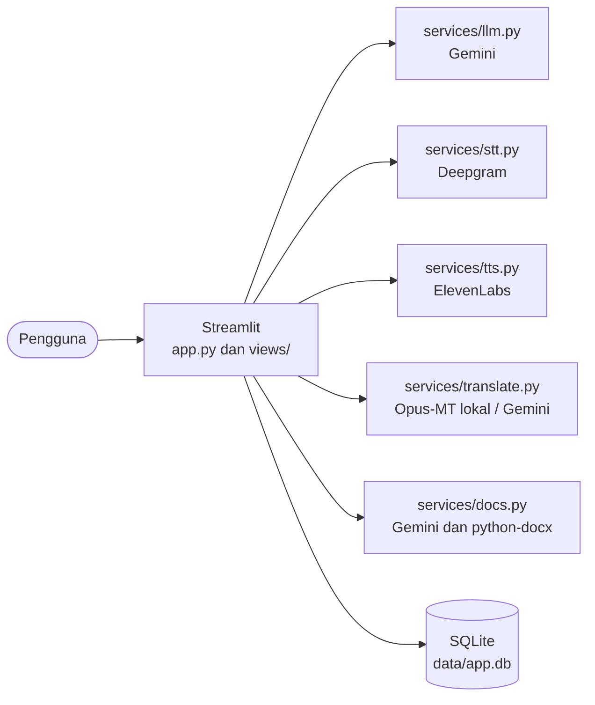

<p align="center">
  
</p>

<p align="center">
  <b>Teman latihan bahasa asing berbasis AI.</b><br>
  Ngobrol lewat teks atau suara, dapat koreksi grammar dalam bahasa Indonesia.
</p>

<p align="center">
  
  
  
  
  
</p>

<p align="center">
  <a href="#fitur">Fitur</a> ·
  <a href="#cara-kerja">Cara kerja</a> ·
  <a href="#mulai-cepat">Mulai cepat</a> ·
  <a href="#konfigurasi">Konfigurasi</a> ·
  <a href="#batasan-yang-diketahui">Batasan</a> ·
  <a href="#lisensi">Lisensi</a>
</p>

---

## Tentang

Fluenta adalah aplikasi Streamlit untuk berlatih bahasa Inggris lewat percakapan dengan tutor AI. Dibuat untuk pemelajar Indonesia, dengan Mandarin dan Jepang sebagai bahasa belajar tambahan. Kamu bisa mengetik atau berbicara langsung, dan tutor membalas dengan teks dan suara. Kesalahan grammar dan tense dikoreksi lengkap dengan penjelasan berbahasa Indonesia.

## Fitur

| Fitur | Keterangan |
|---|---|
| Chat teks dan suara | Rekam suara, kirim otomatis saat berhenti bicara, balasan dibacakan |
| Koreksi grammar | Kalimat diperbaiki dan aturannya dijelaskan dalam bahasa Indonesia |
| Banyak bahasa | Inggris, Mandarin (dengan pinyin), dan Jepang (dengan romaji) |
| Tiga level | Beginner, intermediate, dan advanced menyesuaikan panjang dan kerumitan balasan |
| Riwayat sesi | Semua percakapan tersimpan di SQLite dan bisa dibuka lagi |
| Halaman Dokumen | Unggah PDF, DOCX, TXT, atau gambar, lalu terjemahkan atau rangkum dan unduh hasilnya |
| Halaman Terjemah | Model lokal Indonesia ke Inggris, atau Gemini untuk bahasa lain |
| Halaman Progres | Statistik belajar, koreksi per hari, dan daftar kesalahan terbaru |
| Pola kesalahan | Grafik dan urutan tag kesalahan yang paling sering terjadi |
| Latihan | Latihan ulang dari koreksi baru dengan sistem kotak Leitner |
| Mode ngomong campur | Menerima campuran kata Indonesia dalam pesan tanpa dianggap kesalahan |

## Tampilan

<!--
Tambahkan screenshot ke docs/screenshots/, lalu hapus tanda komentar:

<p align="center">
  
</p>
<p align="center">
  
</p>
-->

_Screenshot akan ditambahkan._

## Cara kerja



Alur percakapan suara:

```
Mikrofon  ->  Deepgram (suara ke teks)  ->  Gemini (tutor dan koreksi)  ->  ElevenLabs (teks ke suara)  ->  Dibacakan
```

| Komponen | Teknologi | Fungsi |
|---|---|---|
| Antarmuka | Streamlit | Chat, navigasi, dan halaman aplikasi |
| Tutor dan dokumen | Google Gemini (`google-genai`) | Balasan, koreksi, terjemahan, ringkasan |
| Suara ke teks | Deepgram | Transkripsi ucapan |
| Teks ke suara | ElevenLabs | Suara balasan tutor |
| Terjemahan lokal | `transformers`, `Helsinki-NLP/opus-mt-id-en` | Indonesia ke Inggris tanpa API |
| Penyimpanan | SQLite | Riwayat sesi, dokumen, dan statistik |

## Mulai cepat

**Prasyarat:** Python 3.12 dan tiga kunci API: Google AI Studio (Gemini), Deepgram, dan ElevenLabs. Aplikasi dikembangkan dan diuji di Windows 11.

```powershell
git clone https://github.com/Skywalker0715/fluenta.git
cd fluenta
python -m venv myenv
.\myenv\Scripts\Activate.ps1
python -m pip install -r requirements.txt
Copy-Item .env.example .env
```

Isi kunci API di `.env`, lalu jalankan:

```powershell
streamlit run app.py
```

Aplikasi terbuka di `http://localhost:8501`. Pemakaian pertama mengunduh model terjemahan lokal (sekitar 300 MB).

## Konfigurasi

Semua nilai dibaca dari `.env`. Tidak ada kunci yang ditulis di dalam kode.

| Variabel | Wajib | Keterangan |
|---|---|---|
| `GEMINI_API_KEY` | Ya | Kunci dari Google AI Studio |
| `GEMINI_MODEL` | Ya | Nama model Flash yang tersedia untuk kuncimu, misalnya `gemini-3.6-flash`. Nama model sering berganti, jadi cek daftar model akunmu |
| `DEEPGRAM_API_KEY` | Ya | Kunci Deepgram |
| `ELEVENLABS_API_KEY` | Ya | Kunci ElevenLabs |
| `ELEVEN_VOICE_ID` | Ya | ID suara kategori `premade`. Akun gratis tidak bisa memakai suara dari voice library lewat API (error 402) |

## Penggunaan

1. **Chat:** ketik pesan, atau klik ikon mikrofon di kolom chat, bicara, lalu diam. Pesan terkirim otomatis.
2. **Bahasa dan level:** pilih di sidebar sebelum mulai berlatih.
3. **Balasan bersuara:** nyalakan atau matikan lewat saklar di sidebar. Matikan untuk menghemat kuota ElevenLabs.
4. **Dokumen:** unggah file, pilih Terjemahkan atau Rangkum, lalu unduh hasilnya sebagai TXT atau DOCX.
5. **Terjemah:** pilih mesin lokal untuk Indonesia ke Inggris, atau Gemini untuk bahasa lain.
6. **Progres:** lihat statistik dan daftar koreksi dari percakapanmu.

## Struktur proyek

```
fluenta/
├── app.py              Router navigasi dan pengaturan halaman
├── db.py               Akses SQLite
├── views/
│   ├── chat.py         Halaman Chat
│   ├── dokumen.py      Halaman Dokumen
│   ├── terjemah.py     Halaman Terjemah
│   ├── progres.py      Halaman Progres
│   └── latihan.py      Halaman Latihan
├── services/           Logika bisnis (tanpa import Streamlit)
│   ├── llm.py
│   ├── fixparse.py
│   ├── practice.py
│   ├── progress.py
│   ├── stt.py
│   ├── tts.py
│   ├── translate.py
│   └── docs.py
├── assets/             Logo, ikon, dan skrip kirim otomatis
├── docs/               Dokumen perencanaan dan arsitektur
├── .streamlit/         Konfigurasi Streamlit
├── .env.example        Contoh konfigurasi
├── LICENSE             Lisensi Apache 2.0
├── NOTICE              Pernyataan hak cipta
└── requirements.txt
```

Folder `data/` dibuat otomatis saat aplikasi pertama dijalankan dan tidak ikut repositori.

## Batasan yang diketahui

- **Kuota gratis terbatas.** Gemini memiliki batas permintaan, dan ElevenLabs sekitar 10.000 karakter per bulan. Pada tier gratis, Google dapat memakai isi percakapan untuk meningkatkan produknya, jadi jangan kirim data pribadi.
- **Kirim otomatis saat diam** memakai JavaScript yang bergantung pada elemen internal Streamlit, sehingga bisa berhenti bekerja setelah pembaruan Streamlit.
- **Mandarin dan Jepang:** koreksi dan balasan teks sudah diuji, tetapi pengenalan ucapan dan kualitas suara untuk dua bahasa itu belum diverifikasi.
- **Belum ada penilaian pelafalan** (pronunciation scoring).
- Berjalan lokal untuk satu pengguna, tanpa login.

## Peta jalan

Ide ke depan, bukan komitmen:

- [ ] Penilaian pelafalan
- [ ] Latihan ulang dari kesalahan lama
- [ ] Deployment dan dukungan banyak pengguna

## Keamanan

`.env` tidak pernah dikomit. Kunci API yang pernah terpapar harus segera dibuat ulang.

## Lisensi

Dirilis dengan lisensi [Apache 2.0](LICENSE). Hak cipta 2026 Rendy Saputra.

Layanan dan model pihak ketiga yang dipakai (Gemini, Deepgram, ElevenLabs, Helsinki-NLP) memiliki ketentuan masing-masing.